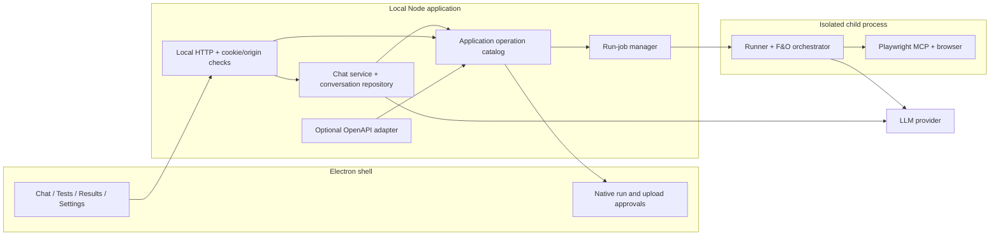

# Application architecture

## Runtime shape

D365FO Agent is a **modular monolith** with a small process boundary around test execution. It is intentionally not a collection of microservices, a Python application, or an Open WebUI plugin.

The Electron shell owns packaging, navigation, and native confirmation dialogs. It contains no model or F&O execution logic. Chat, Tests, Results, and Settings share one browser page and one local authenticated Node service. The runner remains in a child process because it owns browsers/MCP servers and benefits from independent cancellation and cleanup.

## Module ownership

- `src/ui/chat/service.ts`: model/tool loop, turn limits, cancellation, and events. It does not know about HTTP or Electron.
- `src/ui/chat/controller.ts`: authenticated conversation routes, SSE delivery, and per-chat cancellation.
- `src/ui/chat/types.ts`: transport-independent repository and tool contracts.
- `src/ui/chat/store.ts`: atomic JSON conversation persistence behind `ChatRepository`.
- `src/ui/chat/catalog.ts`: converts the application operation catalog into LLM tool definitions.
- `src/ui/tools.ts`: the operation schemas and run/result presentations shared by Chat and the optional OpenAPI adapter.
- `src/ui/server.ts`: composition root and application-operation executor. Live run/upload policy stays in the existing reserved-job path.
- `src/core/runner.ts` and `src/agent/`: test discovery, execution, verification, guardrails, and evidence; unchanged by the Chat architecture.
- `web/`: dependency-free local web UI. `chat.js` is scoped behind the `createChatPage` lifecycle used by `app.js`.
- `desktop/shell/main.mjs`: one web view plus the native rail and approval UI.

The design uses **dependency inversion**, **ports and adapters**, and **controller–service–repository** only where these reduce coupling. No abstract service hierarchy or generic framework is required.

## Security boundaries

The browser API remains loopback-only, token-cookie authenticated, Host-header checked, and protected against cross-origin writes. Provider secrets stay in the Node service and are redacted from Chat errors. The frontend safely renders model/user text through DOM text nodes rather than injected HTML.

Chat operations use the same executor as other application actions. A dry-run remains a diagnostic only. Live runs, reruns, and uploads requested by Chat still require the native approval supplied by Electron; model text cannot approve them. The reservation and history-finalization behavior is shared with page-initiated operations.

The optional `/tools` endpoint is a thin OpenAPI adapter for integration compatibility, not another backend or another implementation of the operations. The old `/model/v1` protocol bridge has been removed.

## Intentional extension points

- **Another provider/protocol:** implement `LlmProvider` and select it in `src/llm/index.ts`. Chat and the test runner use the same interface. Provider adaptation belongs in `src/llm/`, not `web/` or the Electron shell.
- **Token streaming:** extend the provider through an optional streaming method, then map deltas to `ChatEvent`. The SSE controller and frontend event handling do not need to move into the provider. Preserve non-streaming providers as a supported case.
- **Stronger persistence/querying:** implement `ChatRepository` with SQLite or another transactional store. Keep `service.ts` and its tests unchanged. JSON is intentionally sufficient for one local user; do not add a database server just for conversations.
- **New Chat action:** add its schema to `src/ui/tools.ts`, then implement it in the shared executor in `server.ts`. Both the Chat tool schema and the optional OpenAPI document are generated from that catalog. Put native destructive-action approval in the operation, not the prompt or UI.
- **Replacement desktop/web transport:** retain `ChatService`, `ChatRepository`, and the operation executor; replace only the controller or shell.

## Limits and failure behavior

A chat message is capped at 32,000 characters, a conversation at 500 persisted messages, a serialized tool result at 30,000 characters, and a response at 16 consecutive model turns by default. Recent history is trimmed from the provider prompt at 240,000 characters, always starting at a user turn so tool calls stay paired with their results; the complete conversation remains persisted. Chat can be cancelled without deleting history, and a stopped tool batch is closed with explicit cancellation results so the next turn stays valid. Provider failures retain the user message but do not fabricate an assistant answer. Tool failures are returned to the model with progress events rather than crashing the conversation.

## Verification strategy

- Repository tests cover reload durability, concurrent appends, and damaged-file isolation.
- Service tests cover tool ordering, failures, turn limits, and provider outages.
- HTTP tests cover SSE persistence and native approval on the direct Chat path.
- Existing tool API tests continue to prove reservation, approval, progress, results, and comparison invariants.
- Packaged desktop smoke covers conversation CRUD/reload and all four pages, without a model key; `E2E_MODEL=true` adds a real model check when an E2E Anthropic key is supplied.

Run `npm run lint`, `npm test`, `cd desktop && npm run stage`, and package/smoke on each native target before a release.
